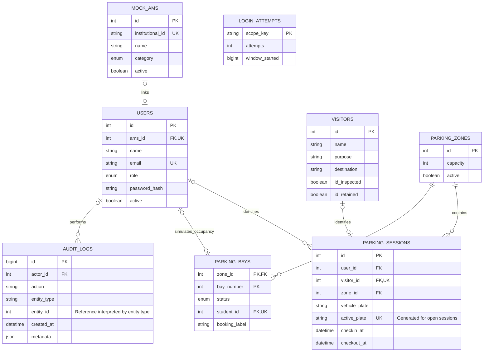
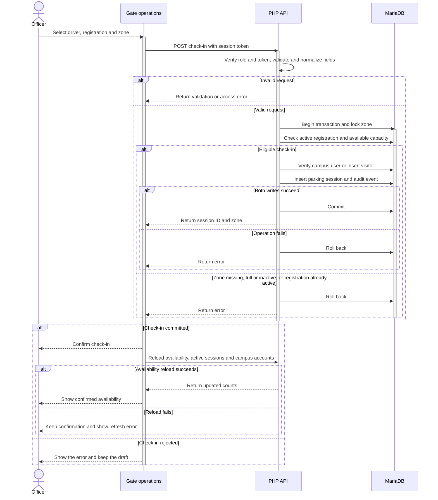

# Strathmore Smart Parking & Access Management System

A Software Engineering class prototype built with PHP, JavaScript and MariaDB. It shows parking availability by zone using arrivals and departures recorded at the gate. All accounts and parking records are fictional.

Open the [latest parking demo deployment record](https://api.github.com/repos/teddexter0/car-park-system/deployments?environment=parking-demo&per_page=1) and follow its `statuses_url`. If the latest status is `success`, open `environment_url` for the public demo. The demo stays online for up to five hours and 45 minutes. The [demo workflow runs](https://github.com/teddexter0/car-park-system/actions/workflows/parking-demo.yml) show the release checks.

The link opens the interactive parking map without an account. Click a vacant bay to simulate arrival and click it again to simulate departure. Each browser tab can simulate one occupied bay at a time. Admin and security sign in to update the shared map and gate records. The hosted demo opens with two fictional examples in Visitor Parking: C02 booked for a directors’ meeting and C03 closed for maintenance.

## What each role can do

| Role | Tasks |
| --- | --- |
| Student | View and simulate occupying one bay at a time. |
| Staff | View available spaces by zone. |
| Gate officer | Check vehicles in and out, record visitors, transfer vehicles between zones and correct missed checkouts. |
| Administrator | Book or close individual bays, manage zones and view reports and the audit log. |

General parking is first come, first served. Green means vacant, yellow previews a gate assignment, red means occupied, grey means unavailable and blue means booked. On the dashboard, a student can click a green tile to simulate a sensor detecting a car. Clicking the same tile again simulates departure. Administrators can select a bay and hold it for a named booking, such as a directors’ meeting, or close it. Booking and closure edits stay in effect until an administrator clears them. Gate records track occupancy by zone and share the same available capacity.

## Run with XAMPP

1. Copy this folder to `C:\xampp\htdocs\car-park-system`.
2. Start **Apache** and **MySQL** in XAMPP.
3. In phpMyAdmin, import `database.sql` once to create and seed the demo database. Then select `strathmore_smart_parking` and import `parking-bays.sql`. For an existing database, import only `parking-bays.sql` into that database to preserve the records.
4. Open [localhost/car-park-system](http://localhost/car-park-system/).

| Role | Demo email |
| --- | --- |
| Student | `student@parking.test` |
| Staff | `staff@parking.test` |
| Gate officer | `security@parking.test` |
| Administrator | `admin@parking.test` |

All demo accounts use `ParkingDemo26!`. The hosted demo uses the public map for students and staff and accepts sign-ins from gate officers and administrators.

Sessions have a 30-minute idle limit and an eight-hour maximum lifetime. Automatic dashboard refreshes leave the idle timer alone. Signing out or changing accounts clears the previous session. Reactivating a disabled account requires that user to sign in again.

## Quick walkthrough

1. Sign in as the gate officer and open **Gate operations**.
2. Choose **Visitor** and enter fictional visit details and a vehicle registration such as `DEMO701`.
3. Select **Visitor Parking** and look for the yellow assignment preview. Check the vehicle in. A fresh database shows availability drop from 12 to 11.
4. Find the vehicle under **Active sessions** and check it out. Availability returns to 12.
5. Search active sessions by registration or by an exact session number such as `#12`. For a transfer, select a different zone with space and record a reason. For a missed exit, enter the correction reason and follow the physical ID reminder if shown.
6. Sign in as the administrator to view zones and the recorded events in the audit log.

The hosted demo starts Visitor Parking at 10 available bays because two bays have example holds. The local walkthrough starts at 12.

## Administration reporting

Reports default to today in Nairobi time (EAT). Enter both dates to include every day from **From** through **Through**. The history list includes sessions with a recorded check-in or checkout during the window. Its search, last assigned zone and current status filters narrow the list. The gate activity totals cover all zones for the selected dates. A transfer keeps the same session, so it adds no entry or exit.

Current occupancy is a live snapshot. It includes gate sessions that are still open and student bay simulations. Bookings and closures reduce availability. For example, a vehicle that arrived yesterday and remains parked counts toward current occupancy. If the gate records its departure today, it counts as an exit today.

Use the visitor’s parking session number, such as `#12`, to find its reporting record. Reports omit visitor names, registrations, purposes, destinations and physical ID details. Gate operations still has the details needed to process active visits. The audit log can filter by date, event and parking session number. Transfer and correction events indicate when a reason was recorded without displaying its free text.

For setup, the acceptance walkthrough, and the verified limits, see [the handover](docs/handover.md).

## Entity relationship diagram

Each parking session has exactly one driver reference, either a campus user or a visitor. A transfer updates the session’s zone. The generated registration on an open session prevents overlapping active sessions for that vehicle. One student may hold at most one simulated bay because `parking_bays.student_id` is unique.

An audit event can have no actor, such as a failed sign-in. The entity reference is interpreted using its type and has no foreign key. The latest account status event supplies the version used to revoke existing PHP sign-ins. Login attempts are grouped by a hash of the request’s remote address.

## Gate check-in sequence

