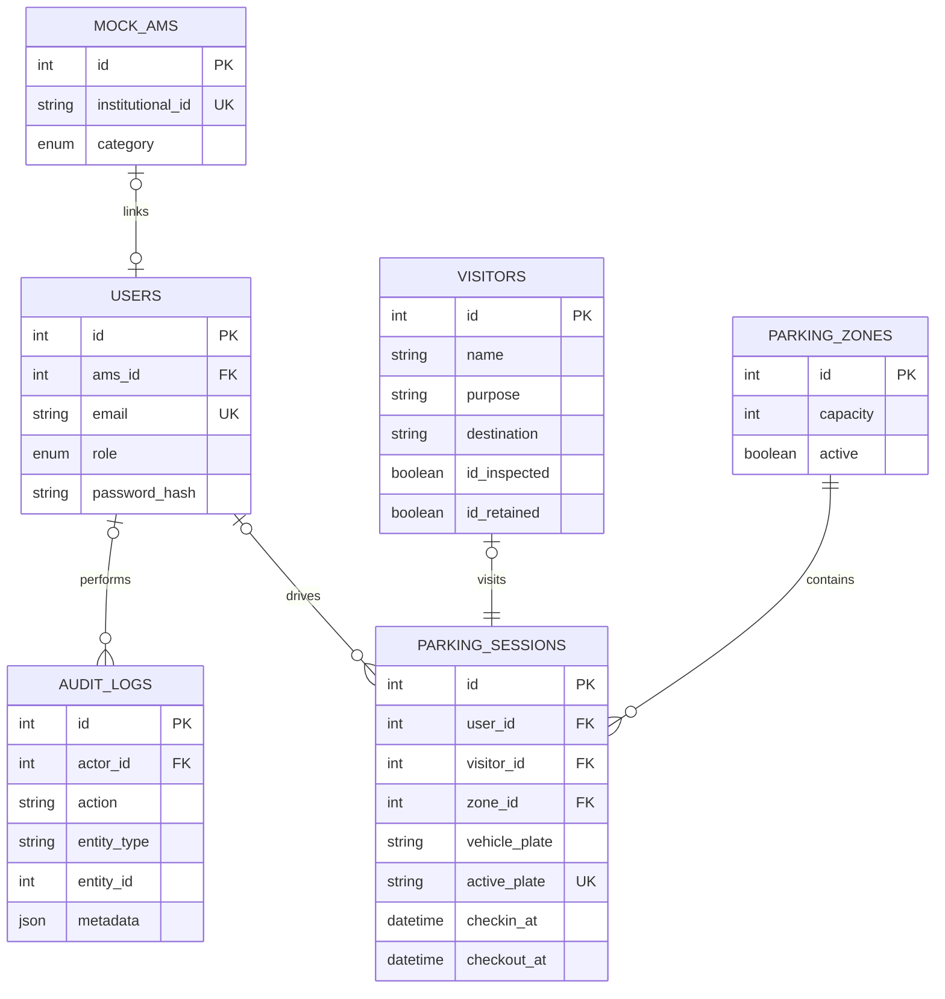
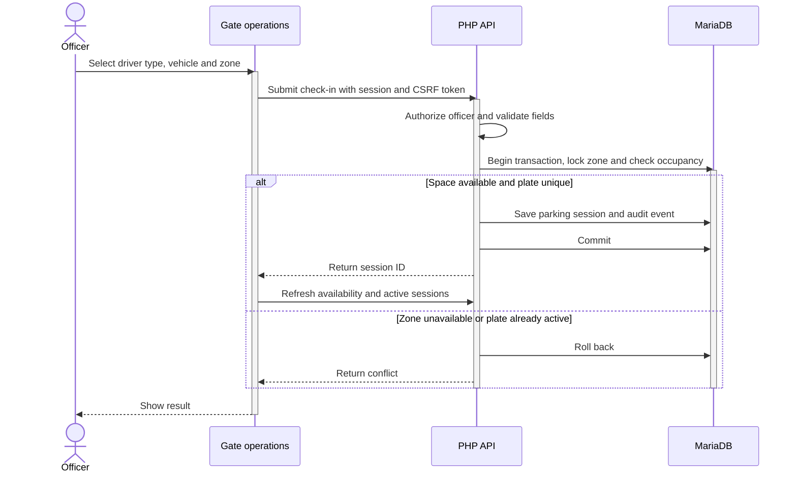

# Strathmore Smart Parking & Access Management System

An unofficial Software Engineering prototype. It uses fictional accounts, vehicles, visitors and parking zones. Use it locally for the presentation.

## Scope

| Original proposal | Implemented scope |
| --- | --- |
| Advance parking reservations | First-come-first-served entry recorded by gate officers |
| Availability per parking space | Capacity and occupancy per parking zone |
| Driver checks in and releases a space | A security officer or administrator records arrival, departure and corrections |

Reservations were removed to match the gate’s first-come-first-served procedure. Tracking zones gives drivers a useful indication of capacity without numbering bays or installing sensors. A visitor can arrive without an account. The officer records a name, visit purpose, destination, vehicle and the status of any physical ID inspected or retained. The application has no national ID number field.

## Run on Windows with XAMPP

1. Start MySQL in XAMPP. For an Apache install, also start Apache and copy this folder into `C:\xampp\htdocs\strathmore-smart-parking`.
2. In phpMyAdmin, open **Import** and import `database.sql`. It creates the `strathmore_smart_parking` database and seeds four accounts, three zones and two active sessions. Import once into a fresh demo database. Set `PARKING_DB_HOST`, `PARKING_DB_PORT`, `PARKING_DB_NAME`, `PARKING_DB_USER` and `PARKING_DB_PASSWORD` in the PHP process if your installation uses custom settings. The defaults are XAMPP’s local root account on port 3306 with an empty password.
3. For Apache, open [http://localhost/strathmore-smart-parking/](http://localhost/strathmore-smart-parking/). To run directly from the project folder while XAMPP MySQL is running, use these PowerShell commands and open [http://127.0.0.1:8080/](http://127.0.0.1:8080/).

```powershell
$env:PARKING_LOCAL_DEMO = '1'
& C:\xampp\php\php.exe -S 127.0.0.1:8080
```

The optional local demo flag reveals credential-fill buttons on loopback only. Those buttons fill the form. The regular login request still verifies the password.

| Role | Demo email |
| --- | --- |
| Student | `student@parking.test` |
| Staff | `staff@parking.test` |
| Gate security officer | `security@parking.test` |
| Administrator | `admin@parking.test` |

All four fictional accounts use `ParkingDemo26!`. The database stores bcrypt hashes.

## Presentation walkthrough

1. Open **Demo tour** and sign in as the student. Show Visitor Parking at 12 available on a fresh database.
2. Sign out and sign in as the administrator. In **Administration → Zones**, create a temporary zone, change its capacity and delete it while it has no session history.
3. Sign out and sign in as security. In **Gate operations**, choose **Visitor**. Enter Quinn Demo, Interview, Careers Office and `DEMO701`. Select Visitor Parking. For the walkthrough, mark the physical ID inspected and retained.
4. Check in the visitor. Show the active record and return to the dashboard. Visitor Parking should show 11 available.
5. Return to Gate operations and check out the vehicle. Show the reminder to return the physical ID. The dashboard should show 12 available again.
6. Sign in as the administrator. Open **Audit log** and **Reports** to show the recorded arrival, departure and zone changes.

## Architecture

The four screens in `index.php` use vanilla JavaScript and Fetch to call `api.php`. PHP sessions carry the account identity and a CSRF token. The API checks account status, role and CSRF before protected operations. PDO prepared statements call InnoDB tables. Dashboard polling runs every ten seconds while that screen is visible and does not extend the idle session.

Each open parking session counts toward its zone’s occupancy. Each change locks the relevant zone row before checking or changing capacity. Transfers lock the two zone rows by ID. A unique generated active plate prevents a vehicle from having simultaneous active sessions, including across zones. A checkout timestamps the session, which releases its space. Mutations and their audit events commit together. Prior session and audit records allow an administrator to trace corrections.

### ERD



A session belongs to exactly one campus user or visitor. Failed sign-in audit entries have no authenticated actor. `login_attempts` stores rate-limit windows independently from accounts.

### Gate check-in sequence



## Test results

Run `& C:\xampp\php\php.exe tests.php` from the project folder. The suite requires PHP cURL and PDO MySQL, and a database account that can create and drop a temporary schema. It creates a randomly named test schema and runs two local PHP servers so it can exercise concurrent requests. It drops its own test schema afterwards.

Executed against PHP 8.2.12 and MariaDB 10.4.32.

| ID | Feature | Method | Expected result | Actual result | Status |
| --- | --- | --- | --- | --- | --- |
| A01 | Sign-in and simulated AMS | HTTP requests with anonymous, invalid and valid student/staff sessions | Valid accounts reach dashboard. Unauthorized requests return 401. | Student and staff signed in. Anonymous dashboard and invalid login returned 401. | PASS |
| A02 | Role access, CSRF and logout | Attempt protected actions from student and officer accounts. Forge a token. Sign out and reuse the session. | Forbidden requests return 403. Logged-out dashboard returns 401. | Observed 403 for denied actions and forged token, then 401 after sign-out. | PASS |
| C01 | Zone CRUD | Create, read, edit and delete a new zone through the API. | Values persist and the deleted row disappears. | Capacity changed from 3 to 5. Name and description persisted. Deleted row disappeared. | PASS |
| P01 | Check-in and availability | Look up an AMS record and check in one student and one staff vehicle. | Two arrivals use two spaces. | The AMS record matched. Availability went from 2 to 1 to 0. | PASS |
| P02 | Capacity, duplicate entry and checkout | Try a duplicate plate in another zone, enter a full zone, delete or shrink an occupied zone, and check out twice. | Invalid actions return 409. First checkout releases one space. | All five conflicts returned 409. Checkout freed one space. | PASS |
| P03 | Visitor, transfer and missed checkout | Submit invalid ID flags, then check in a visitor, search by plate, transfer and correct the departure. Try to delete the used zone and then deactivate it. | Flags and reason are required where applicable. Transfer and exit update counts. History survives deactivation. | Both invalid requests returned 422. Counts changed, checkout returned the ID reminder and the used zone deactivated with history intact. | PASS |
| P04 | Concurrent check-ins | Hold a row lock and fire two requests from independent PHP servers for the final space. | One entry succeeds and one is rejected. | Both requests waited. The responses were 200 and 409, and exactly one vehicle occupied the zone. | PASS |
| R01 | Audit, reporting and privacy | Read audit actions, daily counters and filtered history. Inspect visitor columns. | Required actions and history exist. Only physical ID flags are stored. | All required actions, visitor history and daily counts were present. The visitor table has no national ID number column. | PASS |
| S01 | SQL injection and account status | Send an injection payload, deactivate a staff account, test its access and reactivate it. | Payload and deactivated account are denied. Reactivated account can sign in. | Injection returned 401. Disabled staff lost dashboard access and signed in after reactivation. | PASS |
| S02 | Inactivity timeout | Shorten the timeout to four seconds on test servers. Poll twice. | Polling leaves the idle deadline in place. | First poll returned 200. The next returned 401. | PASS |
| S03 | Login throttling | Reach eight failed attempts from one IP, then send a valid password. | The next attempt returns 429. | The valid-password attempt returned 429 after the eighth failure. | PASS |
| B01 | Presentation flow and responsive layout | Run the walkthrough through Chromium against the seeded MariaDB database. Check dashboard widths of 1280, 768 and 390 px and the gate screen at 390 px. | Demo tour, sign-in, zone CRUD, visitor entry and checkout, audit and reports work. Views fit their widths. | Visitor Parking went from 12 to 11 and back to 12. The ID reminder and audit events appeared. The checked views had no horizontal overflow or uncaught JavaScript errors. | PASS |

## Operating limits

- An officer’s entry, exit or correction changes occupancy. A driver may park in a different zone from the recorded assignment. Real deployment would require consistent gate procedures and could add zone-entrance verification.
- Open sessions older than 12 hours are flagged for review. An officer must confirm departure before closing one.
- Reports and audits display up to 100 matching records. Daily totals use East Africa Time. Reports show the session’s final recorded zone, and the audit log preserves the transfer history.
- The app uses a simulated AMS and fictional accounts intended for an isolated local demonstration. Account management covers activation and deactivation of seeded accounts.
