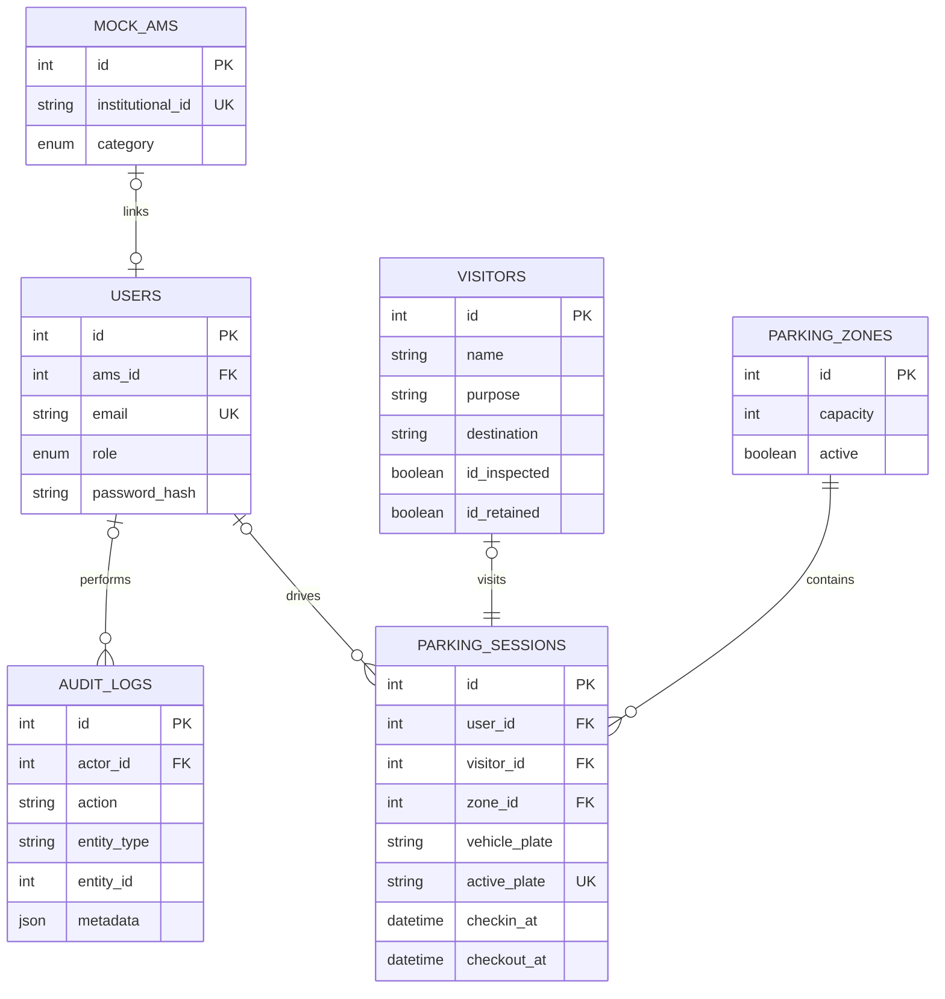
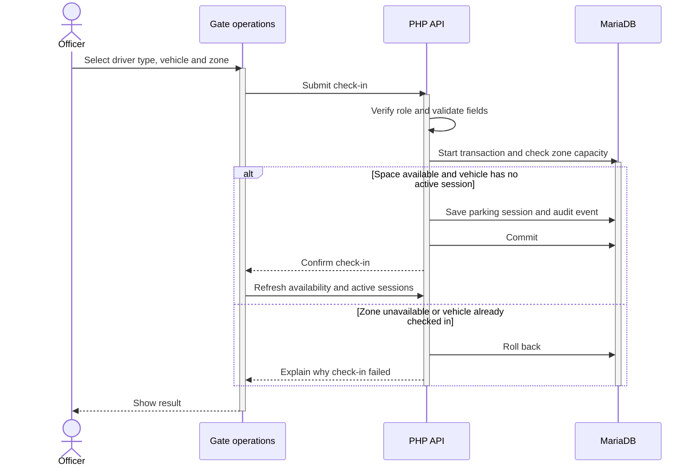

# Strathmore Smart Parking & Access Management System

A Software Engineering class prototype built with PHP, JavaScript and MariaDB. It shows parking availability by zone using arrivals and departures recorded at the gate. All accounts and parking records are fictional.

Use the current demo link shared by the group or follow the XAMPP setup below.

## What each role can do

| Role | Tasks |
| --- | --- |
| Student and staff | View available spaces by zone. |
| Gate officer | Check vehicles in and out, record visitors, transfer vehicles between zones and correct missed checkouts. |
| Administrator | Manage parking zones and view reports and the audit log. |

Entry is first come, first served. The illustrated campus map uses the Central Building, MSB and Library as landmarks for Zones A, B and C. Green tiles show available capacity, yellow previews a zone assignment and red shows occupied capacity. The numbered bays are map labels. Gate records track occupancy by zone.

## Run with XAMPP

1. Copy this folder to `C:\xampp\htdocs\car-park-system`.
2. Start **Apache** and **MySQL** in XAMPP.
3. In phpMyAdmin, import `database.sql` once to create and seed the demo database.
4. Open [localhost/car-park-system](http://localhost/car-park-system/).

| Role | Demo email |
| --- | --- |
| Student | `student@parking.test` |
| Staff | `staff@parking.test` |
| Gate officer | `security@parking.test` |
| Administrator | `admin@parking.test` |

All demo accounts use `ParkingDemo26!`.

## Quick walkthrough

1. Sign in as the gate officer and open **Gate operations**.
2. Choose **Visitor** and enter fictional visit details and a vehicle registration such as `DEMO701`.
3. Select **Visitor Parking** and look for the yellow assignment preview. Check the vehicle in. A fresh database shows availability drop from 12 to 11.
4. Find the vehicle under **Active sessions** and check it out. Availability returns to 12.
5. Sign in as the administrator to view zones and the two events in the audit log.

## Entity relationship diagram

Each parking session belongs to either a campus user or a visitor and is assigned to one parking zone.

## Gate check-in sequence

